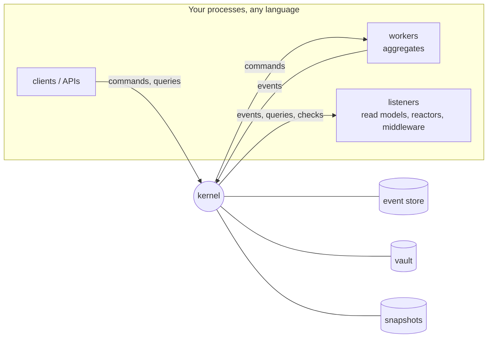
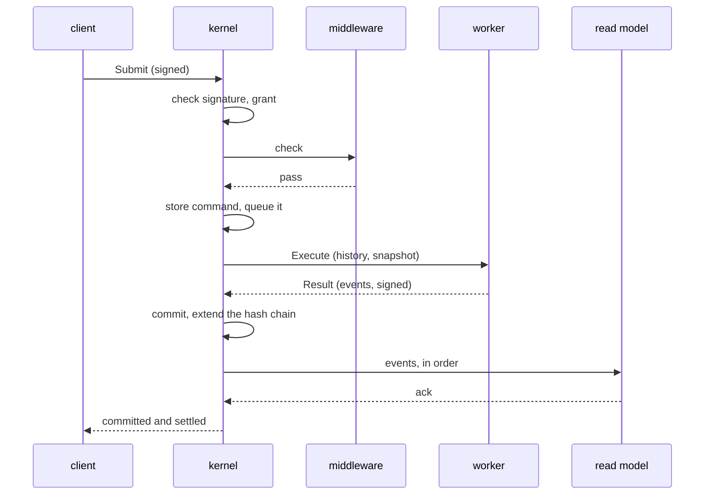

# Architecture

kernable splits an application into a **kernel** and **your processes**.

**The kernel** (Rust, one process per store) owns everything that must be right for every application:

- it checks every signature and every key's grant;
- it queues commands, one at a time per aggregate, and hands them to workers;
- it commits events atomically, on the version they were based on, into a hash chain;
- it delivers events to listeners in a fixed order and waits for them when a submit settles;
- it routes queries to the read model that answers them and runs the middleware chain;
- it keeps personal data in the vault and snapshots in their own store.

**Your processes** own the business logic and nothing else:

- **Workers** run aggregates: given the history and a command, they return new events or a rejection.
- **Listeners** receive events in order: **read models** keep views and answer queries, **reactors** cause side effects and follow-up commands, a **middleware** checks requests.
- **Clients** submit commands and ask queries.

Processes talk to the kernel over gRPC: workers and listeners keep one stream open each, clients make single calls. Any language with gRPC can take part; TypeScript, Python and Rust have SDKs.

## A command's way

The kernel never interprets payloads: commands, events and queries are JSON your processes write and read. That is what lets every process be in another language.

**Limits.** One kernel serves one store; there is no clustering yet. A kernel restarts in seconds and loses nothing (see [Failures and recovery](./failures)).
