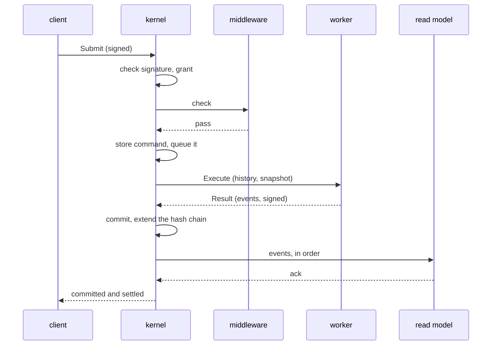
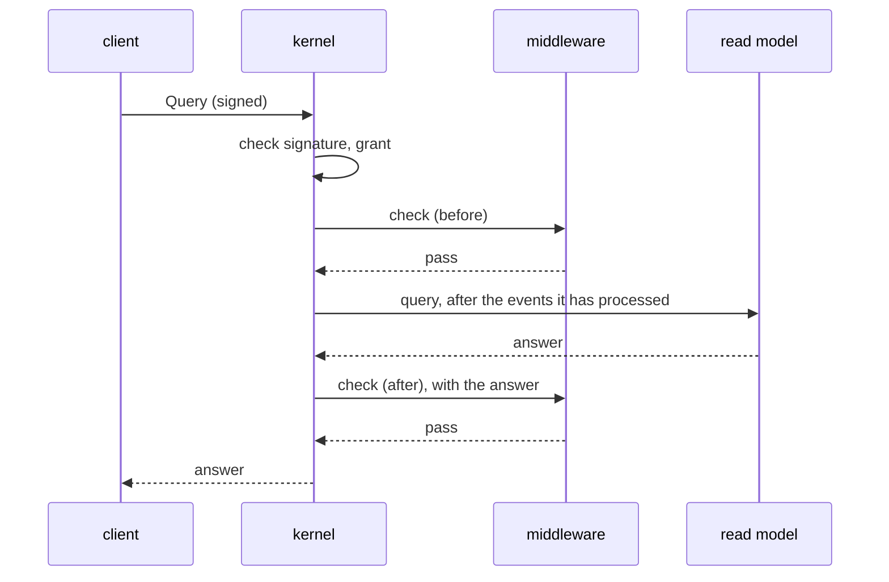

# Architecture

kernable splits an application into a **kernel** and **your processes**.

<FlowDiagram name="architecture" bare :autoplay="false" />

**The kernel** (Rust, one process per store) owns everything that must be right for every application:

- it checks every signature and every key's grant;
- it queues commands, one at a time per aggregate, and hands them to workers;
- it commits events atomically, on the version they were based on, into a hash chain;
- it delivers events to listeners in a fixed order and waits for them when a submit settles;
- it routes queries to the read model that answers them and runs the middleware chain;
- it keeps personal data in the vault and snapshots in their own store, and serves files and a shared cache;
- it knows each **service's membership**: which workers, listeners and middlewares the service consists of, so it waits for exactly those ([Remove a listener, middleware or aggregate](../how-to/remove-listener));
- it shows all of this live in a browser: its [UI](../how-to/monitor#the-ui) maps services, aggregates, events and listeners, lists the connections, and shows any aggregate's history.

**Your processes** own the business logic and nothing else:

- **Workers** run aggregates: given the history and a command, they return new events or a rejection.
- **Listeners** receive events in order: **read models** keep views and answer queries, **reactors** cause side effects and follow-up commands, a **middleware** checks requests.
- **Clients** submit commands and ask queries.

Processes talk to the kernel over gRPC: workers and listeners keep one stream open each, clients make single calls. Any language with gRPC can take part; TypeScript, Python and Rust have SDKs.

## A command's way

<FlowDiagram name="hero" loop bare silent />

What happens to one command, say `shop.PlaceOrder`:

1. **Sent.** A client signs the command with its own key and submits it. A client is just one of your processes: an API, a script, or a reactor reacting to an event.
2. **Checked.** The kernel verifies the signature and checks that the key's grant allows this command type. Then the middleware chain decides, in order; the first rejection refuses the command, and a refused command is never stored.
3. **Stored and queued.** The kernel stores the command and queues it behind the other commands of the same aggregate: one command per aggregate at a time, so nothing overtakes. Two clients changing the same cart run one after the other; different carts run in parallel.
4. **Executed.** A worker gets the command with the aggregate's history, or a snapshot plus the events after it. It runs your handler and returns new events, or a rejection. It signs its result; it changes nothing itself.
5. **Committed.** The kernel appends the events on the version they were based on, atomically, and extends the hash chain. If another command came first, the worker runs it again on the new history.
6. **Delivered.** Listeners get the events in a fixed order: read models (order 0) first, then reactors (order 10), each acknowledging what it has processed.
7. **Settled.** The submit returns once every listener has acknowledged. So the next query, from any process, already sees the change: there is no polling and no "eventually".

The same as a sequence:

## A query's way

<FlowDiagram name="query" loop bare silent />

What happens to one query, say `shop.GetCart`:

1. **Asked.** A client signs the query with its own key and sends it. Like commands, every query goes through the kernel, also when the read model runs in the same process: a shortcut would be the one place where authorization does not apply.
2. **Checked.** The kernel verifies the signature and checks that the key's grant allows asking this query type. Then the middleware chain runs, exactly as for a command; the first rejection refuses the query.
3. **Routed.** The kernel picks a connected read model that answers `GetCart`. If several do, it spreads the queries over them: that is how a read model scales. With `minPosition` (e.g. the position of a `committed` submit), it waits until the read model has processed that event.
4. **Answered.** The read model gets the query on its stream, in order with its events, so its answer reflects every event it was sent before. It answers from its own state, or rejects (`not_found`). Answers are not signed: they travel on the read model's authenticated stream and are not stored.
5. **Checked after.** A middleware after the query sees the request and the answer, and may refuse it instead, for example a cart that belongs to another customer.
6. **Returned.** The client gets the answer or the rejection. After a settled submit, it already shows the change. If no read model answers within `--query-timeout-ms`, the client gets an error.

The same as a sequence:

## What the kernel does not do

The kernel never interprets payloads: commands, events and queries are JSON your processes write and read. That is what lets every process be in another language.

**Limits.** One kernel serves one store; several kernels can [share the tenants](../how-to/partitions), each tenant on one of them. A kernel restarts in seconds and loses nothing (see [Failures and recovery](./failures)), and a [standby](../how-to/standby) holds every write the primary told anyone of; with a witness, it takes over by itself.
