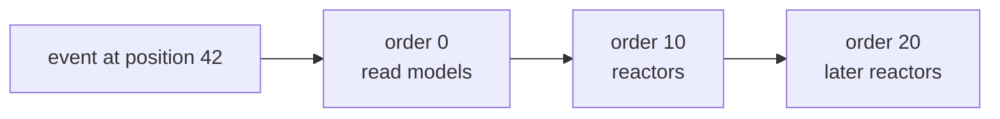

# Order and consistency

kernable gives you a strict order where it matters and parallelism where it does not.

## Commands

- **One at a time per aggregate.** The kernel queues commands per aggregate in submission order and leases one at a time to a worker. Commands of different aggregates run in parallel, on as many workers as you start.
- **Optimistic commit.** A worker's events are committed only on the version they were based on. If the aggregate changed in between, the kernel runs the command again with the new history.
- **Idempotent by ID.** A command ID is stored with the command. Submitting the same ID again returns the original outcome instead of running it twice: give retried commands a fixed ID.
- `expected_version` in the request context rejects a command unless the aggregate is still at the version the client saw.

## Listeners

Events have a **global position**. Every listener receives them in that order, one at a time, and acknowledges what it has processed.

- **Lower orders first.** A listener gets an event only once every listener with a lower order has acknowledged it. Read models default to 0 and reactors to 10, so a reactor's queries always see the event it reacts to. Listeners of the same order run in parallel.
- **At least once.** After a crash a listener gets the events after its last acknowledgement again. Handlers must be idempotent: reactors submit with fixed command IDs, read models overwrite rather than add. A read model with a store writes data and position together and takes effect exactly once.

## Settling: reading your own writes

By default `submit` **settles**: it returns once every listener has processed the command's events. The next query, from anyone, sees the change. No polling, no "eventually".

| `wait` | returns when | use it for |
|---|---|---|
| `settled` (default) | every listener processed the events | APIs that read right after writing |
| `committed` | the events are stored | throughput, or when you do not read back |
| `accepted` (`enqueue`) | the command is stored in the queue | fire and forget; resubmit the ID to get the outcome |

A query can also wait on its own: `minPosition` answers only after the read model has processed that position.

## A listener never waits for itself

A listener handles one event at a time, so a request from inside its handler must not wait for that listener. The SDKs name the listener in such requests, and the kernel adapts:

- a settling submit from a listener waits only for listeners of a **lower** order: a reactor still reads its writes in the read models;
- a query from a listener goes to another read model, or is refused at once instead of timing out;
- a middleware cannot send what it checks itself.
