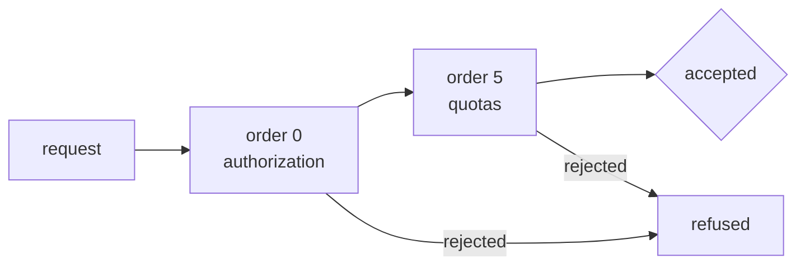

# Queries and middleware

## Every read goes through the kernel

A read model's state is private to its process. Every other process reads it with a **query**, sent to the kernel like a command:

- it is signed, and the key's grant must allow it (`query` to ask, `answer` to answer);
- it passes the middleware chain, exactly like a command;
- the kernel routes it to a read model that answers its type, **in order with that read model's events**: the answer reflects every event the read model was sent before the query.

There are no shortcuts, also not inside one process. A shortcut would be the one place where authorization does not apply.

If several read models answer the same type, the kernel spreads queries over them: that is how a read model scales.

## Middleware

A **middleware** is a listener that checks commands and queries before the kernel accepts or routes them. It builds its knowledge from events, like a read model, and answers each check from it.

- **Registered in code.** A listener declares the types it checks and its order; its key needs a grant for `check` on those types. Negative orders are reserved for kernable.
- **A chain.** Middlewares run by order, then by name; the first rejection refuses the request. A refused command is never stored.
- **Fails closed.** The kernel keeps the registration. While a middleware is away, also right after a kernel restart, every request it covers is refused with `UNAVAILABLE`. Only `kernable listeners remove` unregisters it.
- **Never stale.** After a reconnect, a middleware is asked only once it has processed every event committed before; checks travel in order with its events.
- **Checks only.** A middleware decides; it cannot change a request, because the request is signed.

## The request context

Every command and query carries a signed **request context**: who sends it (`senderIdentity`, `senderTenant`, `senderAccount`, `senderSession`), on whose behalf, its correlation and causation, a trace ID and free attributes. The kernel stores it with every event the command causes, and middleware decides on it. `follow()` gives a follow-up command the context of the event that caused it.
