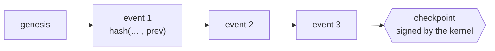

# Trust

kernable assumes that any party may lie, and makes every claim checkable.

## Keys

Every process has an **Ed25519 key** (`kernable keys new`). Its **key ID** is the public key in hex, so a signature can be checked without a registry. Whether a key may do something is decided by the kernel's **allowlists**, per type: `[clients]` may submit `shop.Register`, `[workers]` may run `shop.*`, and so on ([configuration](../reference/configuration)).

## What is signed

| Message | Signed by | Proves |
|---|---|---|
| command | client | who asked for exactly this, in which context |
| result (events, snapshot) | worker | which worker decided, based on which version |
| query, subscription | client | who asked; valid 60 s around its timestamp |
| stream opening | worker, listener | possession of the key (challenge) |
| checkpoint | kernel | the state of the whole log at a position |

Acknowledgements, query answers and middleware verdicts are not signed: they travel on a stream whose key was proven, and are not stored. The exact byte layouts and test vectors are in [Signatures](../reference/signing).

## The hash chain

Every stored event's hash covers its content, its worker's signature, its request context and the previous event's hash. The kernel signs a **checkpoint** of the chain regularly. `kernable verify` recomputes the chain and checks every signature: a changed, removed or reordered event shows, and so does a command without its client's signature. Events after the last checkpoint are protected by the chain only.

## Transport

Over TCP, the kernel requires **mutual TLS**: every process presents a certificate from your CA. Signatures make a message trustworthy; TLS keeps it private and keeps strangers out.

## Privileged switches

The request context is business data and the client decides it, except for **privileged switches** such as `bypass_authorization`, which only keys in `[privileged]` may set. Even then, the middleware decides what a bypass means; the kernel does not skip the chain.
