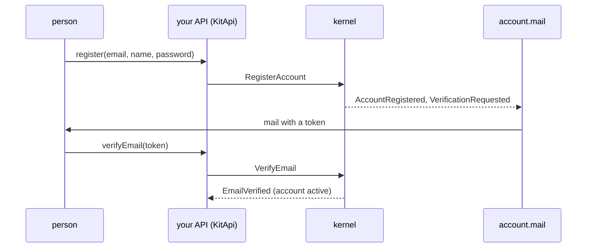

# Accounts and sessions

An account is a person who can sign in: one email address, one password (or none), their second
factors and linked logins. It is the same account in every tenant; what the person may do in a
tenant comes from their [identity](./identity) there. Every account lives in the
[platform tenant](./tenancy#the-platform-tenant).

The `account` domain has three aggregates:

| Aggregate | One per | Lives under |
|---|---|---|
| `account.account` | person | the platform tenant |
| `account.session` | sign-in; ends on sign-out, expiry or revocation | the platform tenant |
| `account.sso` | single sign-on configuration of a tenant | that tenant |

Most of the commands here are sent by your API through [`KitApi`](./api), which picks session
IDs, generates tokens and checks provider answers. The page explains what happens underneath.

## Registration and email verification

- An account starts `pending` and becomes `active` with `VerifyEmail`. The token is valid for
  `VERIFICATION_HOURS` (48) and is erased once used.
- **Registration does not reveal who has an account.** If the address is taken, `register` answers
  exactly as on success. The owner of the address gets a "you already have an account" mail
  instead (`RegistrationAttempted`).
- A registration that expired unverified does not block the address: registering again takes it
  over with a new token.
- Whether anyone may register is the platform's [sign-up policy](./tenancy#the-platform-tenant).
  With `accounts: off`, accounts come only from [invitations](./invitation); an invitation proves
  the email, so such an account is active at once.

## Signing in

`SignIn` checks the password against its argon2id hash and writes either `SignedIn` or
`SignInFailed` with a reason: `wrong_password`, `locked`, `not_verified` or `not_active`. A
missing account answers `wrong_password` too.

**Lockout:** after `LOCKOUT_AFTER` (5) failures in a row, the account is locked for 1 minute, then
2, 4 and so on, at most `LOCKOUT_MAX_MINUTES` (15). The lock is computed from the failures, not
stored, and a successful sign-in resets it. Failed second factors count as well.

After `SignedIn`, a reactor opens the **session** (`OpenSession`). Your API then holds two tokens:

| Token | Lifetime | Checked by |
|---|---|---|
| access token (EdDSA, claims: account, session, factors) | `ACCESS_TOKEN_MINUTES` (15) | your API alone, per request, without the kernel |
| refresh token `<sessionId>.<generation>.<secret>` | as long as the session | the kernel (`RefreshSession`) |

**Refresh tokens rotate.** Each `RefreshSession` issues the next generation. A token from an older
generation is a reuse, a sign that it was stolen, so the session ends at once (`reuse`). Sessions
also end after `SESSION_IDLE_DAYS` (14) without a refresh, and after `SESSION_MAX_DAYS` (90) in
any case.

A short-lived access token does not leave a gap: the middleware learns from the events when a
session ends, an account is suspended or a password changes, and refuses that session's requests
at once.

## Second factors

| Factor | How it is set up | Counts as |
|---|---|---|
| TOTP (an authenticator app) | `StartTotp` with a secret your API generated, then `ConfirmTotp` with the first code; it also creates 10 recovery codes, shown once | the second factor |
| recovery code | from `ConfirmTotp` or `RegenerateRecoveryCodes`; each works once | the second factor |
| passkey (WebAuthn) | `AddPasskey` with the browser's attestation | two factors: it proves possession and the user |

An account with TOTP on needs it in **every** session: until `ProveSecondFactor` (or `ProvePasskey`)
succeeds, the middleware allows nothing but signing out. A [tenant may require](./tenancy#requiring-a-second-factor)
a second factor from everyone in it.

Passkeys can also be the only sign-in method: `SignInWithPasskey` needs no password. Passkeys are
bound to your site: set the relying party with `usePasskeys({ rpId, rpName, origins })`.

## Other ways to sign in

- **Social logins** (Google, GitHub, any OpenID Connect provider): configured in `KitApi`. A
  login that is linked to an account signs in to it. A login whose email nobody has registers a
  new person. A login whose email belongs to an account that has not linked it is refused
  (`not_linked`): the person signs in another way and links it (`LinkProvider`), so nobody takes
  over an account through a provider.
- **Single sign-on per tenant** (`account.sso`): a tenant's owners configure their identity
  provider (`CreateSso`) and add their email domains. A domain counts once its DNS carries the
  TXT record `_kernable-sso.<domain>` (`VerifySsoDomain`, run by your API); each domain belongs to
  one tenant only. People with an address in a verified domain then sign in through that provider,
  and their first SSO login is linked to the account with the same email.
- **Enforced SSO** (`EnforceSso`): in that tenant, only sessions signed in through its SSO count.
  Owners are exempt, so a broken SSO configuration can be mended. The same person may still sign
  in with a password for *other* tenants.

## Changing an account

| Change | Command | What else happens |
|---|---|---|
| password | `ChangePassword` (with the current one, if there is one) | every other session of the account ends; this one stays |
| forgotten password | `RequestPasswordReset`, then `ResetPassword` with the mailed token (valid `RESET_MINUTES`, 60) | every session ends |
| email | `RequestEmailChange`, then `ConfirmEmailChange` with the token mailed to the new address | the old address stays until it is confirmed |

Who may do these: the account itself, or the platform. A person may suspend their own account
(`owner_requested`); suspending for other reasons, reactivating and deleting are the platform's.

**Deleting an account** (`DeleteAccount`, from `suspended`) erases its personal data from every
event of the account and its sessions, and deletes its identities in every tenant. An identity
that still owns a tenant stops this: its deletion parks for an operator until another owner is
found.

## Settings

| Constant | Default | What it does |
|---|---|---|
| `LOCKOUT_AFTER`, `LOCKOUT_MAX_MINUTES` | 5, 15 | failures before the lock, and its longest duration |
| `VERIFICATION_HOURS` | 48 | how long an email verification token is valid |
| `RESET_MINUTES` | 60 | how long a password reset token is valid |
| `ACCESS_TOKEN_MINUTES` | 15 | the access token's lifetime |
| `SESSION_IDLE_DAYS`, `SESSION_MAX_DAYS` | 14, 90 | when a session ends without a refresh, and at the latest |
| `PASSKEYS` | `localhost` | the relying party; set it with `usePasskeys` |
| `CHALLENGE_SECONDS` | 300 | how long a passkey challenge is valid |

The password hash parameters (argon2id, 19 MiB, 2 iterations, OWASP's recommendation) are in
`shared/secrets`.

## Reference

<!--@include: ./generated/account.md-->
