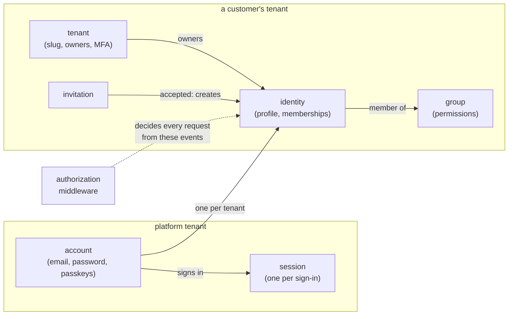

# The kit

Almost every application needs the same groundwork before its own domain: tenants for its
customers, people who sign in, their roles, invitations, and a check on every request. The kit is
that groundwork as source code: `kernable-sdk add kit` copies it into your project, and from then
on it is yours. Change fields, rules and flows, or delete what you do not need.

It is written for TypeScript, Python, Rust and Go. All four write the same events and pass the
same test cases, so an API in TypeScript and a service in Rust or Go work on one log.

## What is in it

| Domain | What it holds | Page |
|---|---|---|
| `tenancy` | One tenant per customer organisation: its slug, status, owners, MFA requirement, and the platform's sign-up policy | [Tenancy](./tenancy) |
| `account` | A person's account, the same in every tenant: email, password, TOTP, passkeys, OAuth/OIDC logins; a session per sign-in; a tenant's single sign-on | [Accounts and sessions](./account) |
| `identity` | A person or service inside one tenant: profile, group memberships, API keys | [Identities](./identity) |
| `group` | Named sets of permissions per tenant | [Groups](./group) |
| `invitation` | Invitations by email into a tenant, with groups or as owner; invitation links many people join through | [Invitations](./invitation) |
| authorization | The middleware that decides every request, relations, lists filtered by the same rules, `Explain` | [Authorization](./authorization) |
| `KitApi` | What only your HTTP API does: sign-in, tokens, passkey challenges, OIDC, API keys | [Your API: KitApi](./api) |

## How the parts fit

- An **account** is the person: one email, one password, their second factors. It lives in the
  platform tenant, so the same person signs in once and works in several tenants.
- An **identity** is that person *inside one tenant*. Permissions belong to identities, not
  accounts, so the same person can own one tenant and be a guest in another. Services (other
  programs) have identities too, with API keys instead of an account.
- A **group** is a named set of permissions in a tenant, such as "Customers may place orders and
  cancel their own". A tenant's **owners** hold every permission in it; they form a virtual group.
- The **middleware** runs before every command, query, file and cache request. It learns from the
  kit's events and decides from what it knows, without a database call.

## What "yours" means

The kit is not a dependency you update. `add kit` copies it once, with the version of your SDK;
each copied file says which version it came from. Every change it makes is an event in your log,
so the kit's audit trail is your log: sign-ins, failed attempts, memberships, invitations.

A newer kit is never installed over yours. To take something from it, copy it into another
directory and move over what you want. The kit's test cases (`kit/fixtures`, the same JSON for
every language) tell you which of its rules you changed.

## Start here

1. [Getting started](./getting-started): copy the kit, run it, grant its keys, sign people in.
2. The page of each domain, for its rules, flows and settings, with a generated reference of its
   commands, events and queries at the end.
3. [Recipes](./recipes) for common changes: sign-up modes, enforced MFA, single sign-on, API keys
   for services, removing a domain you do not need, adding a field.

Personal data (emails, names, IP addresses, password hashes) lives in the [vault](../concepts/data)
and is erased with the person; the kit's events mark which fields go there. Read
[Trust](../concepts/trust) first if keys, grants and the request context are new to you.
