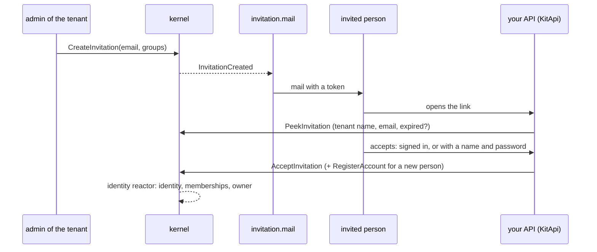

# Invitations

An invitation brings a person into a tenant by email: with some groups, or as an owner. It works
for people who already have an account and for people who do not, and it is the only way in when
the platform's sign-up policy keeps registration closed. An [invitation link](#invitation-links)
lets many people in through one link instead.

One aggregate, `invitation.invitation`, with a random ID, under the tenant it invites to. It is
`open` until it is `accepted`, `declined` or `revoked`; it expires after `INVITATION_DAYS` (7),
which is computed, not an event. Each tenant holds at most one open invitation per email.

## The flow

1. **Inviting.** `CreateInvitation` with the email and the groups (each optionally scoped to one
   aggregate). The inviter may only hand out groups they could grant themselves
   ([no escalation](./authorization#no-escalation)). Owner invitations (`owner: true`) are for
   owners and the platform.
2. **The mail.** The reactor sends a token of the form `<tenantId>.<invitationId>.<tokenId>.<secret>`,
   so the token alone tells your API which tenant to accept it in. The token waits in the vault
   until it is used; `ResendInvitation` replaces it with a new one.
3. **The acceptance page.** Your API calls `peekInvitation(token)` to show the tenant's name and
   whether the invitation expired.
4. **Accepting**, through `KitApi.acceptInvitation(token, as)`:
   - **Signed in**: the account's email must be the invited one (else `wrong_email`).
   - **New person**: they choose a name and password; the account is registered at once and is
     active, since the token proved the email. Someone whose email already has an account must
     sign in first (`sign_in_first`), so nobody ends up with an account they cannot use.
5. **Afterwards**, the identity reactor creates the person's identity in the tenant (or keeps the
   one they have), grants the invitation's groups, and adds them as owner for an owner invitation.

The invited person may also **decline** (`DeclineInvitation` with the token). The tenant's admins
may **revoke** an open invitation.

## Invitation links

An invitation link lets people in without an invitation per email: Ann puts a link on her shop's
website, and whoever opens it, signs in and joins gets the link's groups. It is a second
aggregate, `invitation.link`:

| Command | What it does |
|---|---|
| `CreateInvitationLink` | a link into `groups` (never as owner), optionally with a `label`, an expiry (`expiresAt`) and a limit (`maxUses`) |
| `JoinWithInvitationLink` | the signed-in account joins the tenant with the link's groups; sent by your API |
| `RevokeInvitationLink` | the link stops working at once |

- **Creating** goes through `KitApi.createInvitationLink(context, tenant, { groups, label?, expiresAt?, maxUses? })`.
  It generates the token `link_<tenantId>.<linkId>.<secret>` and returns it **once**; only its
  hash is stored, as for API keys. The creator may only hand out groups they could grant
  themselves ([no escalation](./authorization#no-escalation)).
- **Joining** goes through `KitApi.joinWithInvitationLink(claims, token)`. The person must be
  signed in: unlike an emailed invitation, a link proves no email address, so someone new
  registers and verifies first, then joins. Each account joins through a link once; a link that
  expired, is used up or was revoked is refused (`expired_token`, `used_up`, `invalid_token`).
- **Afterwards** the identity reactor creates the person's identity in the tenant (or keeps theirs)
  with the link's groups, exactly as for an accepted invitation. Every join is an event
  (`InvitationLinkUsed`), so the audit shows who came in through which link.
- `peekInvitationLink(token)` gives the join page what it shows: the tenant, the link's label and
  whether it can still be used. `ListInvitationLinks` lists a tenant's links with how often each
  was used.

## Tenants created by the platform

When the platform creates a tenant for someone (`CreateTenant` with `owner: { email }`), the kit
sends that person an owner invitation. Accepting it makes them the tenant's first owner.

## Personal data

An invitation keeps its email after it is closed, so the audit shows who was invited and when.
`EraseInvitation` removes it, when the person asks or when the tenant is deleted (a reactor does
that for every invitation of the tenant).

## Reference

<!--@include: ./generated/invitation.md-->
