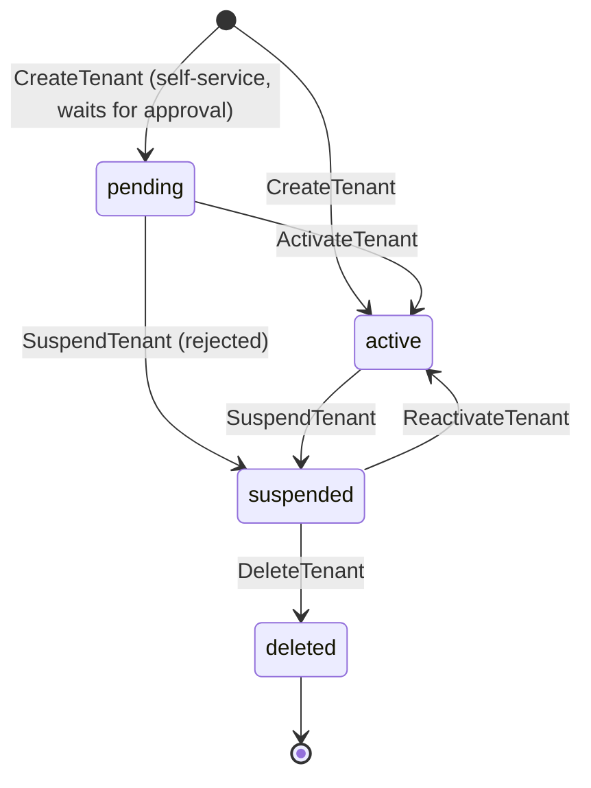

# Tenancy

A tenant is one customer organisation of your application: a company using your SaaS, a school,
a shop. Everything that belongs to it (its identities, groups, invitations, and your own
aggregates) lives under its tenant ID, so the kernel keeps tenants apart and can erase or move one
as a whole.

## The tenant

One aggregate, `tenancy.tenant`, whose ID *is* the tenant ID: a tenant `acme` lives under the
tenant `acme`. It holds:

| Field | What it is |
|---|---|
| `slug` | a short name for URLs and subdomains (`acme.example.com`): 3–63 lowercase letters, digits and single dashes, unique across tenants, not one of `RESERVED_SLUGS` |
| `name` | the display name |
| `status` | `pending`, `active`, `suspended` or `deleted` |
| `owners` | the identities that own it; at least one once the first owner joined |
| `suspension` | why it is suspended: `owner_requested`, `unpaid`, `abuse`, `by_platform` or `rejected` |
| `mfaRequired` | whether everyone in it needs a second factor |
| `signUp` | the platform tenant only: the sign-up policy |

### Lifecycle

- A **suspended** tenant keeps its data, but the middleware refuses its requests (`tenant_suspended`).
  The platform can still act on it; its owners can reactivate it only if they suspended it
  themselves (`owner_requested`).
- **Deleting** is only possible from `suspended`, after `DELETE_AFTER_DAYS` (0 by default). It frees
  the slug, and the kit's reactors delete the tenant's identities and erase the emails of its
  invitations, both with their personal data; then every kit read model drops the tenant's rows. Your own read models should do the same on
  `tenancy.TenantDeleted`.
- A rejected self-service tenant (`rejected`) cannot be reactivated.

## The platform tenant

One tenant is special: the **platform tenant** (`PLATFORM_TENANT`, `platform` by default). It is
where every account and every session lives, and where the people who run your application have
their identities. Its groups hold their permissions **in every tenant**, and its owners hold every
permission everywhere. It cannot be suspended or deleted. `bootstrap()` creates it.

Its tenant also holds the **sign-up policy**, changed with `ChangeSignUpPolicy`:

| Setting | Values | Effect |
|---|---|---|
| `accounts` | `off`, `open` | `open`: anyone may register. `off`: accounts come only from invitations |
| `tenants` | `off`, `pending`, `active` | whether a signed-in person may create a tenant themselves, and whether it starts `active` or waits as `pending` for the platform's `ActivateTenant` |

## Owners

Owners are kept on the tenant itself, nowhere else. They hold every permission in their tenant
and appear in group lists as the virtual group `owners`, which cannot be deleted. The last owner
cannot be removed (`last_owner`).

How the first owner arrives depends on who creates the tenant:

- **Self-service**: a signed-in person sends `CreateTenant` with `owner: { accountId }` (their own
  account). The kit creates their identity in the new tenant and adds it as owner.
- **By the platform**: `CreateTenant` with `owner: { email }`. The kit sends an owner invitation
  to that address; accepting it adds the person as owner.

An identity that owns its tenant cannot be deleted; remove it as owner first. The kernel checks
this atomically through the tenant's `owner` key.

## Requiring a second factor

`RequireMfa` with `required: true` makes the middleware refuse every request in the tenant from a
session without a second factor (`mfa_required`): TOTP or a recovery code proved in this session,
or a passkey, which counts as two factors. API keys of service identities are not affected.

## Settings

In `kit/src/shared/constants.ts` (Python: `kit/shared/constants.py`, Rust: `src/shared/constants.rs`):

| Constant | Default | What it does |
|---|---|---|
| `PLATFORM_TENANT` | `platform` | the platform tenant's ID |
| `RESERVED_SLUGS` | `platform`, `www`, `api`, `admin`, `app`, `mail`, `auth`, `login`, `static` | slugs nobody may take |
| `DELETE_AFTER_DAYS` | `0` | how long a suspended tenant waits before it may be deleted |

## Reference

<!--@include: ./generated/tenancy.md-->
