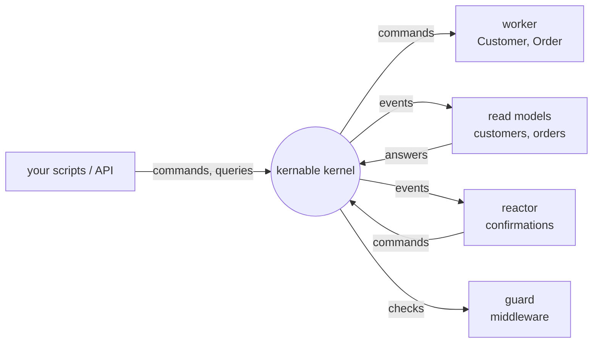

# Build a shop

In eight parts you build a small shop on kernable: customers register and place orders, a service confirms every order by email, customers may only touch their own data, and a customer can have their personal data erased. In the last part it runs as it would in production.

Every part shows the code in **TypeScript and in Python**; pick one with the tabs, or mix them: part 5 is about exactly that.

| Part | You add | You learn |
|---|---|---|
| [1. Run a kernel](./1-kernel) | `kernable.toml`, keys, `connect` | what the kernel does and what your processes do |
| [2. Aggregates and commands](./2-commands) | `Customer`, `Order`, the worker | commands, events, rejections, idempotency |
| [3. Read models and queries](./3-queries) | `customers`, `orders` | queries through the kernel, reading your own writes |
| [4. A reactor](./4-reactor) | `confirmations` | listener order, follow-up commands |
| [5. A second language](./5-languages) | nothing new | mixing languages in one application |
| [6. Authorization](./6-authorization) | `guard` | middleware, the request context |
| [7. Personal data](./7-personal-data) | vault declarations, erasure | the vault, secrets, erasing a person |
| [8. Operate](./8-operate) | a production config | mutual TLS, metrics, readiness, persistent read models, deploys |

From part 2 on, the snippets show what a part adds to a file, without its imports. The complete files, as they are at the end, are in the repository under `docs/examples/shop/ts` and `docs/examples/shop/py`; kernable's tests run them for every part, in both languages.

You need Rust (stable), Node.js ≥ 22.18 for TypeScript or Python ≥ 3.10 for Python, and about an hour.
